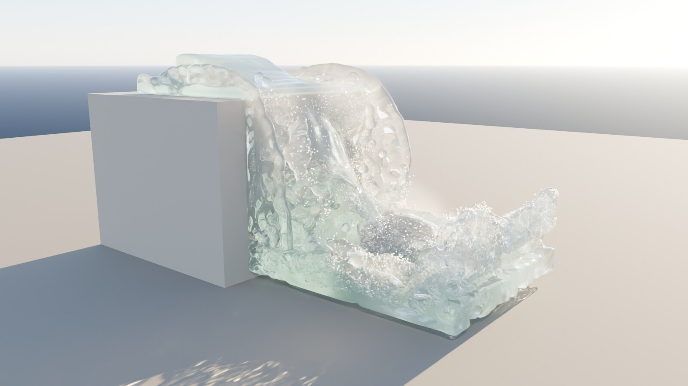
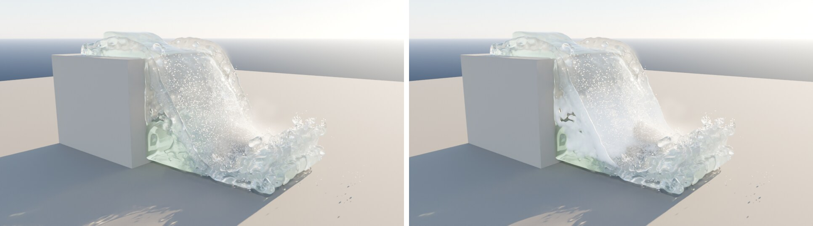
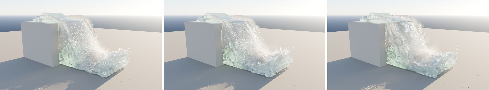
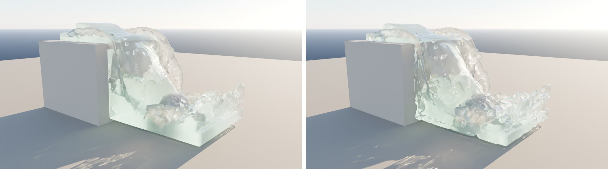

  

<h1 align="center">HyprW — Hyper Realistic Water</h1>

  A water simulation add-on for Blender, built on measured physics instead of values tuned by eye.

  
  
  
  
  

  <a href="https://github.com/FAAAHHH/HyprW/releases/latest"><b>Download</b></a> ·
  <a href="#installation">Install</a> ·
  <a href="#new-in-140">What's new</a> ·
  <a href="#features">Features</a> ·
  <a href="#tests">Tests</a>

HyprW runs its own simulation on the
[FLIP Fluids](https://github.com/rlguy/Blender-FLIP-Fluids) engine (MIT,
bundled and extended) and takes care of everything around it: the water
surface, whitewater, mist, wind, drops on the camera lens and materials.
Wherever it can, it uses measured physics with a source; where it has to
approximate, the code and the help texts say so. The FLIP Fluids add-on is
**not** needed.

## New in 1.4.0

### Measured materials

  
   
  <b>Aerated Falling Water.</b> Left: the breakup length computed for this scene (11.4 m) — a 2 m fall stays nearly clear, as in nature. Right: breakup at 2 m, as for water that has fallen as far as in a tall fall.

- **Aerated Falling Water** (on): falling water takes up air and turns white
  the further it falls, fully white at its breakup length — from the jet
  breakup of Ervine et al. (1997) with the turbulence at the edge measured by
  Carrillo et al. (2020). The bake now stores the surface's velocities, which
  also give Cycles motion blur.
- **Ripples From Wind** (on): wind roughens the surface as Cox & Munk (1954)
  measured it — 0.32 at 2 m/s, 0.40 at 5 m/s, 0.48 at 10 m/s.
- **Wet Obstacles** (off): rocks and banks turn darker with a water film from
  the frame the water reaches them (Lekner & Dorf 1988: an albedo of 0.3
  becomes 0.18). Works on coarse obstacles too.
- **Foam Decay** (3 s): foam thins out as it ages instead of vanishing at once
  (Callaghan et al. 2012: 1.4–4.8 s on the sea).
- **Traced Caustics** (off): Cycles traces the light the simulated waves
  throw onto the ground. Sharper network than the pattern, but measured 31 %
  darker on average — the method is approximate.
- Foam brightness checked against field measurements: a foam particle
  reflects 31 %, within the measured 22–55 %.

## New in 1.3.0

### Turbulent inflows

  
   
  Inflow turbulence <b>0 %</b> (before) · <b>10 %</b> (new default) · <b>25 %</b>. Same scene, frame 48.

An inflow used to emit every particle with one velocity: a perfectly smooth
slab of water that stays smooth and looks rigid. Rivers are turbulent —
Nezu (1977) measured the fluctuations in open channels, 7–15 % of the mean
speed for typical rivers. **Inflow › Turbulence** gives the leaving water
such eddies: a divergence-free field with a Kolmogorov spectrum (Kraichnan
1970), carried with the flow (Taylor 1938); **Eddies** sets the size of the
largest swirls (0 = the inflow's thinnest side).

The inflow still delivers the water it should: +0.4 % at 10 %, +7 % at
25 % (measured without an outflow; smaller time steps alone add 1.7 %).
On by default at 10 % — set 0 % for the smooth inflow of 1.2.

## New in 1.2.0

### A water surface that holds the water

  
   
  <b>Left:</b> the engine's union of spheres (1.1.0). <b>Right:</b> Anisotropic Surface (1.2.0). Same simulation, Mesh Detail 2, one frame apart.

Water meshed from round particle blobs swells: on the scene above it holds
19 % more water than its particles stand for, and pools look like gel.
**Water Mesh › Anisotropic** stretches every particle's kernel along the
surface (Yu & Turk 2010), smooths the field and cuts it exactly where it
holds the particles' volume — new every frame.

| Surface | Water volume vs. particles | Time per frame |
|---|---|---|
| Spheres (before) | +19 % | — |
| Anisotropic, Mesh Detail 2 | +0.9 to +1.0 % | 1.7 s |
| Anisotropic, Mesh Detail 3 | +0.4 % | 2.9 s |

Over 15 frames the volume changes by at most 0.2 % from frame to frame: no
flicker. **Smoothness** sets how calm the surface looks. Times include the
simulation step (Resolution 80, 160,000 particles). Off by default.

### Also new

- **Resume a bake** — a bake keeps saved states every few frames; a stopped
  or crashed bake continues from the last one.
- **Blender stays usable while baking** — the bake computes in a worker
  thread; Cancel takes effect when the frame being computed is done.
- **Liquids** — water, olive oil, glycerol, honey or lava with measured
  viscosity, density and surface tension.
- **Hybrid Water** (formerly Adaptive Particles) with one **Strength**
  lever from 1 to 6.
- **Resolution up to 8192**; the panel warns when the grid alone exceeds
  this computer's memory.
- **Light Playback** — smooth timeline playback: a simplified mesh and
  fewer whitewater points while playing, full quality when paused and in
  renders.
- **An (i) next to every setting** — hover for the short version, click for
  how to use it and the technical background with sources.

All changes: [release notes](https://github.com/FAAAHHH/HyprW/releases).

## Features

**Own simulation** — mark objects with a role (Domain, Water, Obstacle,
Inflow, Outflow, Mist Domain, Spray Domain) in the *HyprW* panel and press
Bake. Results are drawn as light previews and loaded per frame from the
cache. While baking the panel shows the frame, a progress bar and the time
left.

**Hybrid Water** — deep below the surface pairs of particles merge into
larger ones; near the air, near obstacles and in fast flow they split back,
so the surface stays as fine as the domain resolution (Adams, Pauly, Keiser
& Guibas 2007). Test scene, 30 frames on the GPU: 2.76 million particles
carried by 1.39 million, 75 s → 64 s, same volume.

**GPU** — surface mesh, whitewater, water particles, advection and pressure
can each run on the CPU or an NVIDIA GPU (RTX 20xx or newer). Mesh,
whitewater and water particles are bit-identical to the CPU. **Pick the
Fastest per Step** measures both devices on a copy of your file instead of
guessing. Waterfall test scene: 1.67x faster in total.

**Whitewater** — foam, bubbles and spray as point clouds with a size spread
and motion blur. Foam is aerated water (20 % air, 1 mm bubbles): the light
path through every particle is solved in the shader, so it renders the same
on CPU and GPU. Checked against Cycles path-tracing the same medium.

**Water** — absorption of pure water (Pope & Fry 1997), dissolved organic
matter and the murkiness of real rivers, set as **visibility** — how far a
black object can be seen under water (4.8 / attenuation, Davies-Colley
1988). Thin water stays clear, deep water takes its colour by itself. Light
reaches the ground through the surface, with caustics, capillary ripples at
1.71 cm and optional dispersion with water's measured refractive index per
colour (Daimon & Masumura 2007).

**Liquids** — viscosity is solved implicitly (Batty & Bridson 2008), so even
lava stays stable; surface tension gets the time step it needs. A drop
without gravity oscillates within 10 % of Rayleigh's period.

**Mist** — spray breaks up into mist after literature values (air break-up,
impact splashing), drifts with wind and is rendered as a volume.

**Wind** — acts on whitewater in the air and on a thin layer of the water
surface, against moving air instead of still air. Shown in m/s and Beaufort.

**Lens drops** — drops on the camera lens driven by the simulation: spray
and mist that reach the camera land, merge, slide and leave trails, with
contact angles of real glass coatings.

**Grid overlay** — the simulation grid on the domain walls in the viewport,
so you see whether an obstacle is thick enough for the resolution.

## Installation

1. Download `hyprw-<version>.zip` from
   [Releases](https://github.com/FAAAHHH/HyprW/releases/latest).
2. Blender: *Edit → Preferences → Get Extensions → Install from Disk*.
3. The tab **HyprW** appears in the 3D viewport sidebar (N).

Requirements: **Blender 5.2 or newer** (tested on 5.3.0), **Linux x86-64**
with a libstdc++ from GCC 13 or newer (Ubuntu 24.04, Fedora 39 and later).
The bundled engine (`ffengine/lib/libffengine.so`) is built for Linux. For
Windows or macOS, build the engine from FLIP Fluids' source with
`engine_patch/` applied (see `engine_patch/README.md`) and put the library
into `ffengine/lib/`. GPU support needs an NVIDIA driver; without one
everything runs on the CPU.

## Layout

    sim/                    own simulation: bake, cache, display, look, lens
    operators/              one module per feature
    properties/             settings per scene and object
    ui/                     sidebar panels, help texts, grid overlay
    ffengine/               the FLIP Fluids engine (MIT) and its Python API
    engine_patch/           HyprW's engine extensions, with documentation
    tests/                  background test, see below
    docs/                   images for this page

## Tests

    blender -b --factory-startup --python tests/blender_kameratropfen.py -- <path to this folder>

300 checks: bake, the bake's worker thread, the anisotropic surface's
volume, inflow turbulence, measured materials (wind, foam, caustics, wet
obstacles, aerated water), viscosity and surface tension, saved states and resuming, roles,
obstacle sheets, Hybrid Water, GPU against CPU, playback, materials, lens
drops, register and unregister.

## License

The add-on is GPL-3.0-or-later (`LICENSE.md`). The engine in `ffengine/`
and the engine patch are MIT (`ffengine/LICENSE_MIT.md`). Third-party code
inside the engine library is listed in `THIRD_PARTY.md`.
